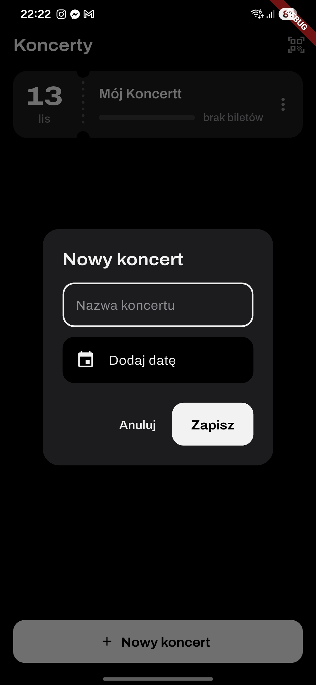
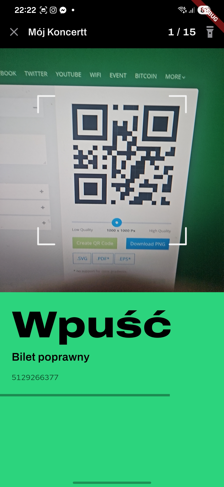
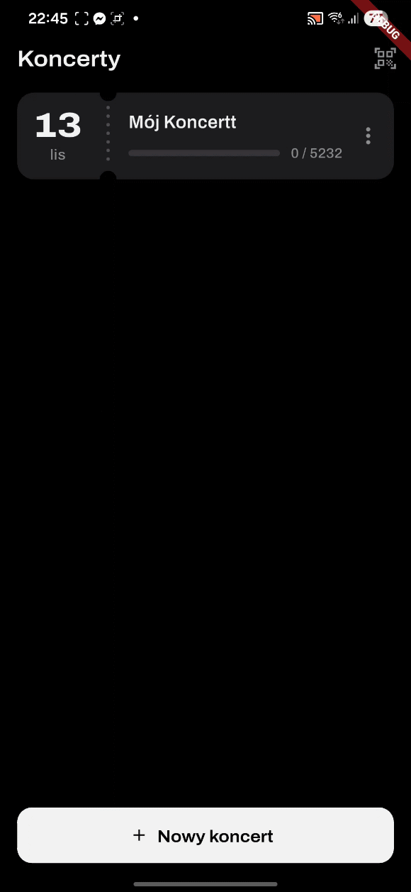
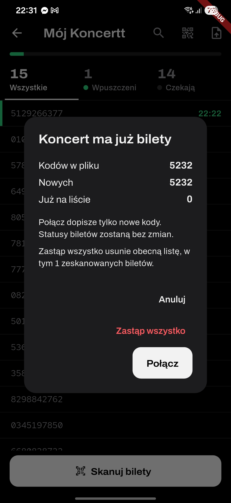

# MarshallTickets

Skaner biletów na wydarzenia/koncerty działający bez dostępu do sieci.

# Dlaczego? 

Istniejące skanery biletów są dostarczane przez bileterie - zazwyczaj są niedopracowane i niewygodne w użyciu. Ta aplikacja jest niezależna i pozwala na bardzo szybkie skanowanie biletów, oraz łatwą obsługę skanowania na dedykowanym telefonie bez dostępu do sieci, który można zostawić na bramce w klubie.

Dodatkowo, mało która aplikacja wspiera kody zawierające link do strony jak jest np. w przypadku WooCommerce Tickets. 

# Jak to działa?

W aplikacji tworzymy wydarzenie z datą i nazwą. Data jest używana wyłącznie do sortowania wydarzeń na liście. Wydarzenia z dzisiaj, lub z obecnego weekendu są wyświetlane wygodnie na górze listy.



Do wydarzenia można zaimportować listę kupionych biletów w formacie `.txt` (jeden kod na linię) lub `.csv`. Następnie można zeskanować kody QR lub kody kreskowe (EAN-13/8, UPC-A, Code128, Code39) przy wejściu na koncert. Aplikacja sprawdza, czy kod jest ważny i czy został już zeskanowany. Wyniki są wyświetlane w czasie rzeczywistym.

### Przykładowy plik z biletami w formacie `.txt`:

```
1234567890123
ABCDEF123456
XYZ123154
https://sklep.mójzespół.pl/?event_qr_code=1&ticket_id=86101&event_id=7041&security_code=9bdba65a1e&path=wp-json%2Ftribe%2Ftickets%2Fv1%2Fqr
```

Poprawny Bilet           |  Niepoprawny Bilet 
:-------------------------:|:-------------------------:
  |  

# Importowanie koncertu z kodu QR

Jeśli na bramcę wydarzenia korzystasz z dedykowanego telefonu do skanowania biletów, nie musisz łączyć go z internetem ani ręcznie pobierać na nim listy biletów.

Wystarczy, że zrobisz to na swoim głównym telefonie. 

Aplikacja pozwala na wygenerowanie kodu QR dla całego koncertu, który może zostać odczytany przez dedykowany telefon na bramce. Wtedy wszystkie kody biletów razem z nazwą i datą koncertu zostaną automatycznie zaimportowane do aplikacji na tym telefonie.

Wszelkie zmiany wprowadzone na głównym telefonie (np. dodanie nowych biletów) mogą być ponownie zaimportowane na dedykowany telefon, który będzie miał zawsze aktualną listę biletów.

Funkcja ta działa dla dowolnej liczby kupionych biletów. Przy większej liczbie biletów aplikacja wygeneruje wiele kodów QR, które będą się wyświetlać w serii.

### Import biletów z kodu QR:


# Kolidujące dane

Przy imporcie biletów aplikacja wykryje nowe i już istniejące kody. Spyta o to jak je połączyć.

Import za pomocą kodu QR z innej aplkacji zastępuje status istniejących biletów.
Import z pliku nie wprowadza zmian w statusach już istniejących biletów.



## Uruchamianie

```
flutter run
```

Made using Claude Code
